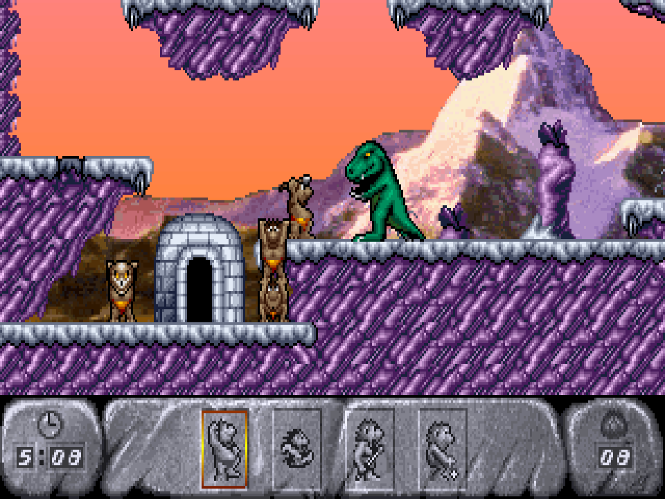

# Almost Humans

## Introduction 

'Almost Humans' is a reverse engineered port of the DOS CD version of "The Humans" by Imagitec Design, 1992.

The game is a mix between platform and puzzle, with some distant hints of "Lemmings". You can read about it on [Wikipedia](https://en.wikipedia.org/wiki/The_Humans_(video_game)).

You can still buy it on [GOG](https://www.gog.com/en/game/the_humans_bundle) for a few €/$/whatever. 

## 🤖 Disclaimer 🤖

Work on this port was started as an experiment to check the usability of a cheap open-weight LLM in my reverse-engineering workflows (See the section "[Tools](#tools)" below).

I usually don't release my experiments nor LLM written code, but given that this ended up quite playable, I don't like wasting effort, I'm having fun cleaning it up and plan to keep improving it, I decide to release it for everyone to use.

But I respect and understand the choice of people wishing to steer clear of code that has ties to LLM, so I want to be clear with this:

- Reverse engineering of the original DOS executable was aided by an LLM
- Some of the code was written by an LLM, some by me, most was re-worked and cleaned up by me
- The architecture of the port is mine (and took some hints from codebases I worked on in the past: ScummVM, Reminiscence, RAW...)

## SDL3 port

**TODO**

### Playing

**TODO**

### Building

**TODO**

## Credits

**TODO**

## Tools

**TODO**

- Ghidra
- ghidrassistMCP
- dosbox-automation
- dosbox-mcp
- VSCodium
- DeepSeek v4.1 Flash
